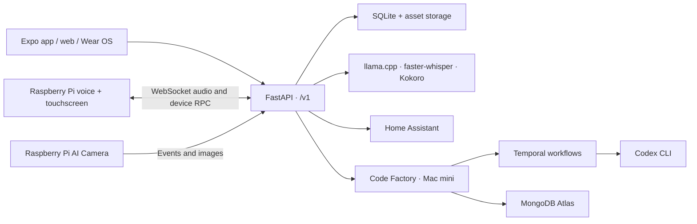

# Jarvis

Jarvis is a personal assistant that connects local AI inference, household devices, and
mobile, web, and watch interfaces. It supports text and voice conversations, smart-home
controls, camera alerts, reminders, and coding and research tasks.

The repository contains the backend, client applications, device software, protocol
definitions, tests, and deployment scripts. The main deployment runs on an NVIDIA Jetson
AGX Orin, with Raspberry Pi voice and camera devices and a separate Mac mini for coding
and research jobs. Core conversation, speech recognition, speech synthesis, and image
description run locally; integrations such as web search and coding tasks use external services.

## What it does

- **Conversation:** streaming chat, attachments, project context, and persistent memories
  through a shared agent and tool interface.
- **Voice:** local wake-word detection, speech activity detection, interruptible playback,
  and a touchscreen interface on Raspberry Pi devices.
- **Home and cameras:** capability-based controls through Home Assistant, live camera
  views, on-device person detection, spoken announcements, and Android push notifications.
- **Personal tools:** todos, shopping lists, timers, alarms, Gmail search/read access,
  and Spotify playback on voice devices.
- **Coding and research:** submit tasks from clients or conversation, follow progress,
  cancel or queue follow-ups, and view completed research reports.

Jarvis also provides the conversation service used by
[Sherman](https://github.com/dsorensen228/sherman), a separate desktop robot project.

## Architecture



The API owns authentication, application data, device coordination, and the agent's tool
loop. Model servers run in separate processes with small HTTP interfaces. This keeps GPU
dependencies out of the API and allows an API release without restarting model services.

A voice turn starts with wake-word detection and WebRTC VAD on the Pi. A persistent
WebSocket carries PCM audio to the API, which coordinates transcription, the agent turn,
and speech synthesis. The same connection carries device commands and playback
acknowledgments. The local Python process serves the React touchscreen through a loopback
facade, so the browser does not receive device credentials.

## Technology and repository layout

| Component | Technologies | Role |
| --- | --- | --- |
| [API and agent](apps/api) | Python, FastAPI, Pydantic, asyncio, SQLite | Versioned HTTP/WebSocket API, authentication, persistence, streaming responses, and tool execution. |
| [Mobile and web](apps/mobile) | TypeScript, React Native, Expo | Shared application for chat, tasks, devices, cameras, and settings; hosted web and signed Android builds. |
| [Touchscreen](apps/device-ui) | TypeScript, React, Vite | Kiosk UI for voice devices, including timers, cameras, music, and task progress. |
| [Wear OS](apps/wear) / [Wear Factory](apps/wear-factory) | Kotlin, Jetpack Compose, Gradle | Watch interfaces for spoken assistant turns and coding/research tasks. |
| [Voice devices](devices/voice) | Python, openWakeWord, WebRTC VAD, PipeWire, USB audio | Microphone capture, wake-word detection, ReSpeaker hardware support, playback, and local UI services. |
| [Camera devices](devices/camera) | Python, Picamera2, Sony IMX500 | Capture and person detection on the camera; registration and events through the API. |
| [Inference services](services) | llama.cpp, Qwen, faster-whisper, Kokoro | Local language and vision inference, speech recognition, and speech synthesis. |
| [Code Factory](services/code-factory) | Python, FastAPI, Temporal, MongoDB Atlas, Codex CLI | Durable task execution, lifecycle tracking, progress streaming, and report storage. |
| [Contracts](contracts) | OpenAPI, JSON, documented realtime protocols | Shared interfaces across Python, TypeScript, and Kotlin without cross-application imports. |
| [Deployment](deploy) / [scripts](scripts) | Docker Compose, systemd, launchd, Cloud Run, EAS | Service packaging, device installation, hosted web deployment, and signed Android releases. |

Each deployable owns its runtime version, dependency manifest, and build process. Python
versions differ where hardware libraries require it; JavaScript and Kotlin retain their
own toolchains. There is no repository-wide Python environment.

## Implementation details

- **Persistence and credentials.** The API uses SQLite in WAL mode and stores binary assets
  separately. Personal-integration credentials are encrypted before storage. Human clients
  exchange an allowlisted Google identity for an API session; device access has its own
  authentication path. See [storage](apps/api/src/jarvis_api/store.py) and
  [authentication](apps/api/src/jarvis_api/auth.py).
- **Model requests.** Tool schemas are selected for the request, and chat can load additional
  tools during a turn. Stable instructions and schemas precede changing context to enable
  llama.cpp prefix reuse. Model streams record first-token latency and cache metrics.
  See [tool policy](apps/api/src/jarvis_api/tool_policy.py) and
  [inference client](apps/api/src/jarvis_api/inference.py).
- **Smart-home interfaces.** Home Assistant owns device integrations. Jarvis exposes
  components and reported capabilities through a common model, so clients do not need
  vendor-specific control logic. See [smart-home code](apps/api/src/jarvis_api/smarthome).
- **Background work.** Code Factory uses Temporal for workflow execution and MongoDB for
  task records and bounded progress history. It handles cancellation, worker restarts,
  dependent follow-ups, and separate coding/research results. Research HTML is sanitized
  before storage. See [workflows](services/code-factory/src/code_factory/workflow.py) and
  [research processing](services/code-factory/src/code_factory/research.py).
- **Notification delivery.** Android alerts persist recipients, track provider tickets and
  receipts, retry transient failures, and remove invalid device tokens. See
  [push delivery](apps/api/src/jarvis_api/push.py) and
  [task notifications](apps/api/src/jarvis_api/task_notifications.py).

## Development and verification

This is a hardware-backed personal system. A full deployment requires model files, device
hardware, and integration credentials; these are not included. Individual components can
be developed and tested separately.

For the API, install `uv` and run:

```bash
make api-sync
make api-test
make api-lint
```

For the TypeScript clients, use Node.js 20.19 or later and npm:

```bash
make device-ui-sync device-ui-build
make mobile-sync mobile-typecheck mobile-web
```

The repository includes Python unit and integration tests, TypeScript/React component
checks, Playwright browser tests, and Kotlin tests. Examples cover
[voice protocol handling](apps/api/tests/test_voice.py),
[push delivery](apps/api/tests/test_push.py),
[prompt caching](apps/api/tests/test_prompt_cache.py), and
[task workflows](services/code-factory/tests/test_workflow.py).

Component READMEs cover setup and test commands. Start with the
[architecture notes](docs/architecture.md), [API guide](apps/api/README.md),
[Jetson deployment](deploy/jetson/README.md), or
[Mac task host](deploy/macmini/README.md) for more detail.

## Repository status

Development and device releases use a separate Git workflow. This GitHub repository is a
manually published snapshot for browsing the project; it is not the deployment upstream.
The [UNO Q spinner branch](https://github.com/dsorensen228/jarvis/tree/codex/uno-spinner)
contains separate device firmware and deployment work that has not been merged into `main`.

Deployment addresses, account identifiers, and machine-specific settings in this public
copy are illustrative placeholders. Supply your own configuration before deploying.
